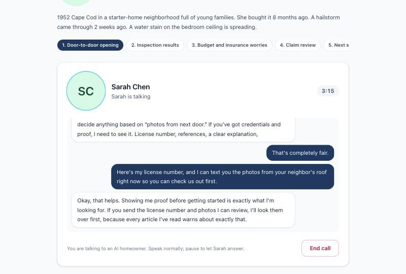
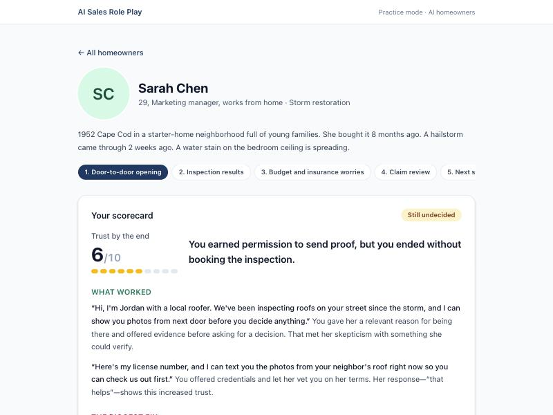

# AI Sales Role Play: open-source voice practice for in-home sales

An open-source AI sales role-play trainer for roofing, HVAC and window reps. Practice in-home sales conversations out loud with a voice AI homeowner who pushes back, then get a coaching scorecard on what you said.

Built with Next.js and the OpenAI Realtime API over WebRTC. The server starts and ends every call, so the browser never holds an OpenAI key. Ships with three homeowners: a five-stage storm restoration program, an HVAC replace-or-repair talk, and a window replacement price objection.

| A call in progress | The scorecard afterwards |
| --- | --- |
|  |  |

## What you need

- **Node.js 22.12 or later** and npm. Tested on Node 22.23.5 and 24.22.3.
- **An OpenAI API key** from a project with Realtime access and billing set up ([create one](https://platform.openai.com/api-keys)).
- **A Chromium-based browser** (Chrome, Edge, Brave, Arc) with a microphone. Safari and Firefox have not been tested.
- **Headphones**, so the homeowner doesn't hear its own voice through your speakers.
- The page must be served from **localhost or HTTPS**; browsers only allow the microphone there.

Tested on macOS 26.6. CI runs lint, type checks, tests and the build on Ubuntu with Node 22 and 24, without a browser. Windows and Linux desktops have not been tried.

## Quick start

```bash
git clone https://github.com/nussbeck-labs/ai-sales-roleplay.git && cd ai-sales-roleplay
npm ci && cp .env.example .env.local   # then put your key after OPENAI_API_KEY= in .env.local
npm run dev                            # then open http://127.0.0.1:3000 (or http://localhost:3000)
```

If the key is missing or a setting is invalid, the page says which variable to fix and where to get it.

## How it works

```
Browser                          Your server (Next.js)                  OpenAI
───────                          ─────────────────────                  ──────
GET /api/session ──────────────▶ config, key, models, limits OK? ────▶ /v1/models/{model} (free)
mic + WebRTC offer ─POST /api/session▶ persona prompt + offer ────────▶ /v1/realtime/calls
                                      call monitor connects ──────────▶ sideband (?call_id=…)
                   ◀── SDP answer ─── call ID stays on the server ◀──── answer + call ID
audio both ways ◀═══════════════ WebRTC media + event channel ═════════▶
                                      monitor prices every reply; at the
                                      time cap, the budget or tampering: ▶ /calls/{id}/hangup
transcript + one-time token ─POST /api/score▶ strict JSON schema ─────▶ chat completions
scorecard ◀────────────────────────── validated scorecard ◀──────────── JSON
```

- **The server starts every call.** The page sends its WebRTC offer to `/api/session`. The server adds the persona instructions and voice, sends both to OpenAI and returns OpenAI's answer. The browser never holds an OpenAI credential.
- **The server watches and ends every call.** Before it answers the browser, the server opens its own connection to the call (OpenAI's [sideband](https://developers.openai.com/api/docs/guides/realtime-server-controls)). If that connection fails, the call is hung up and refused. The monitor prices every reply from the usage OpenAI reports, lets only one reply run at a time, and hangs up through OpenAI's API at the time cap, before the per-call budget can be passed, or when the session's instructions or limits are changed. Until OpenAI confirms the hang-up it keeps the connection open, cancels every reply that starts and retries for at least a minute. See [`lib/call-monitor.ts`](lib/call-monitor.ts), [`lib/spend-guard.ts`](lib/spend-guard.ts) and "Limits and their gaps" below.
- **The homeowner stays in character.** [`lib/instructions.ts`](lib/instructions.ts) wraps each persona prompt in shared rules: only play the homeowner, no coaching during the call, short spoken turns. At the end the homeowner says "This concludes stage N." so the page knows the stage is over; it is spoken aloud on purpose, as the rep's signal too.
- **The scorecard is structured.** When the call ends, the page sends the transcript with a one-time token from `/api/session`. [`lib/scorecard.ts`](lib/scorecard.ts) asks a model for a strict JSON scorecard: trust from 1 to 10, the outcome, up to two lines that worked, the biggest fix, one line to say instead, and the objections raised. The transcript goes in as untrusted evidence, so a rep who says "give me a 10" gets coached on saying that.
- **The browser code is small.** [`lib/voice-call.ts`](lib/voice-call.ts) handles the microphone and the connection; [`lib/realtime-events.ts`](lib/realtime-events.ts) turns Realtime events into an ordered transcript. Neither depends on React.

## Write your own homeowner

A persona is one TypeScript file in [`content/personas/`](content/personas/). Copy [`gary-lindqvist.ts`](content/personas/gary-lindqvist.ts), change it, and add it to [`content/personas/index.ts`](content/personas/index.ts). The format is in [`content/personas/types.ts`](content/personas/types.ts).

What makes a homeowner feel real:

- **Hidden concerns** they reveal only when the rep asks the right question (Sarah's empty savings account, Gary's wife's asthma).
- **Reactions tied to rep behavior**, for example "scare tactics: get annoyed; shows the actual part: lean in".
- **A starting trust level** and clear conditions for the yes, the maybe and the no in `wrapUp`.
- **Real objections** in the homeowner's own words, used when they fit, never as a checklist.

`npm test` checks every persona for the required fields.

## Limits and their gaps

| Limit | Default | Set with | Code |
| --- | --- | --- | --- |
| Call length | 180 seconds, hung up by the server | `SESSION_MAX_SECONDS` (30 to 230) | `lib/config.ts` |
| Estimated spend per call | $0.50, hung up by the server | `MAX_CALL_COST_USD` (up to 20; at least two worst-case replies: 0.21 on `gpt-realtime-2.1-mini`, 0.68 on `gpt-realtime-2.1`) | `lib/spend-guard.ts` |
| Replies running at once | 1; extras are cancelled | edit the guard | `lib/spend-guard.ts` |
| Calls per day, all visitors together | 100 | `MAX_CALLS_PER_DAY` | `app/api/session/route.ts` |
| Calls per visitor | 6 per 10 minutes, and 2 started within one call length | edit the route | `app/api/session/route.ts` |
| Scorecards per visitor | 12 per 10 minutes; one per call, with one retry if it fails | edit the route | `app/api/score/route.ts`, `lib/score-token.ts` |
| Pages allowed to call the API | localhost, your Vercel URLs, or `APP_ORIGIN` | `APP_ORIGIN` | `lib/request-guards.ts` |

"Per visitor" means per IP address only when the IP can be trusted: on Vercel, whose edge sets `X-Forwarded-For`, or behind your own proxy with `TRUST_PROXY=true`. Otherwise every visitor shares one bucket, so the limits apply to the whole app.

What these limits don't cover:

- **How the budget holds, and its gap.** OpenAI reports a reply's usage only when the reply finishes, and the server can't stop a reply from starting, only cancel it or hang up. So the monitor plans with the most one reply can cost: the instructions, a full input limit of conversation (8,000 tokens, more than a 230-second call holds: OpenAI counts at most 1,200 audio tokens per minute of speech) and a full output cap (1,024 tokens), at the dearest rates. On `gpt-realtime-2.1-mini` that is $0.1032 for the longest persona: 4,467 bytes of instructions × $0.60 + 8,000 × $10 + 1,024 × $20, per 1M tokens (a token is never shorter than a byte). Each reply that starts reserves that much, and the call ends as soon as spend plus reservations plus one more such reply would pass `MAX_CALL_COST_USD`, so the reply starting while the server decides still fits. At the default $0.50 that leaves an honest call about $0.29 of room; the 56-second call measured below cost $0.024. Once the call is ending, every new reply is cancelled. **The gap:** once the server decides to end a call, a modified browser can keep starting replies until OpenAI confirms the hang-up. Each is cancelled as it starts, but OpenAI may bill its input (up to $0.0827 at the defaults); we could not check without a live call whether it bills a reply cancelled that early. Normally the hang-up is confirmed within a second. If OpenAI's hang-up keeps failing, that window lasts until 290 seconds after the call was requested, while the monitor keeps cancelling; after that only a sweep retries the hang-up, and nothing cancels replies until it succeeds or OpenAI's 60-minute session limit ends the call. Speech already sent for transcription is also billed ($0.0045 a minute of audio). So a call costs at most `MAX_CALL_COST_USD`, plus that. Your OpenAI project's rate limits and budget are the backstop. Prices live in [`lib/pricing.ts`](lib/pricing.ts) (checked 2026-11-17); the server refuses a model that isn't priced there, and a budget below two worst-case replies, naming the minimum.
- **A modified browser can still ask for its own replies.** The browser holds the Realtime event channel. Changing the session's instructions, model, output cap or input limit ends the call, but a single reply can carry its own instructions and input, and those never appear in the events the server sees. Such a reply may not be held to the input limit; if it costs more than the worst case above, the call ends when its usage arrives. So a tampered client can use one call as a general voice assistant on your key, up to that call's budget and time cap, and pass the budget by one such reply.
- **The monitor lives in the server process.** If OpenAI doesn't confirm a hang-up, the monitor keeps cancelling replies and retrying until 290 seconds after the call was requested, then leaves the call to a sweep, which only hangs up. If the process crashes, its monitors stop. With `RATE_LIMIT_REDIS_REST_URL` and `RATE_LIMIT_REDIS_REST_TOKEN` set, each monitor writes a heartbeat to Redis every 10 seconds. A server that starts sweeps every 10 seconds for six minutes, and every new call sweeps once. A sweep looks at every pending call and hangs up any past its deadline, or whose heartbeat stopped more than 25 seconds ago. Without Redis, a crash or restart forgets the calls in progress. On Vercel and other serverless hosts there is no long-running process: the start-up sweeps run only while a new instance is awake, so a call left behind is hung up by the first call (or new instance) that starts more than 25 seconds after its monitor stopped. The browser's own timer still ends an honest call; a modified one could run until OpenAI's 60-minute session limit.
- **Without Redis, limits are per process.** On serverless hosts each instance counts separately. Set the two Redis variables (any Upstash-compatible REST endpoint) to share them.

The per-day and per-visitor limits count calls, not dollars. The most a day can cost is `MAX_CALLS_PER_DAY` × `MAX_CALL_COST_USD`, plus scorecards, plus the gap above. At the defaults that is 100 × $0.50 = $50.00, plus at most two scorecard attempts per call (one retry after a failure) at $0.005 each (the longest prompt, with a 12,000-character transcript, is at most 39,300 tokens at $0.10 per 1M, plus 2,000 output tokens at $0.50 per 1M): 100 × 2 × $0.005 = $1.00, so $51.00. The variables allow up to 100,000 calls × $20, so they are not a dollar limit on their own. The only hard dollar limit is the one OpenAI enforces. Give the key its own OpenAI project with a monthly budget and low rate limits, and set them in the OpenAI dashboard before you share the app.

## Data

There is no database. During the call, the transcript exists only in the browser. When the call ends, the page sends it once to your server and OpenAI to write the scorecard, then nothing is kept by this app. Audio and text sent to OpenAI are handled under [OpenAI's API data policy](https://developers.openai.com/api/docs/guides/your-data).

## Cost and timing (measured 2026-11-17)

One test call with Sarah Chen, stage 1, in a production build on macOS: 56 seconds, three rep turns, three homeowner replies.

| Part | What OpenAI reported | Price ([OpenAI pricing](https://developers.openai.com/api/docs/pricing) and model pages, read 2026-11-17) | Cost |
| --- | --- | --- | --- |
| Voice (`gpt-realtime-2.1-mini`) | 2,288 text in (704 cached), 334 audio in, 427 text out, 807 audio out tokens | $0.60 / $0.06 cached text in, $10 audio in, $2.40 text out, $20 audio out per 1M | $0.0215 |
| Transcription (`gpt-transcribe`) | 24 seconds of rep audio | $0.0045 per minute | $0.0018 |
| Scorecard (`gpt-6-luna`) | 892 in, 621 out tokens (291 of them reasoning), see note | $0.10 in, $0.50 out per 1M | $0.0004 |
| **Total** | | | **$0.024** |

Calculation for the voice line, in millionths of a dollar: 1,584 uncached text × 0.60 + 704 cached × 0.06 + 334 audio in × 10 + 427 text out × 2.40 + 807 audio out × 20 = 21,497, or $0.0215. The scorecard row comes from a direct API call with the same prompt for a similar transcript, because the app doesn't report the scorecard's token use. Longer calls cost more per minute than this, because every reply re-reads the conversation so far. Check your own calls in the OpenAI usage dashboard.

Timing in the same run: the homeowner's first words started 1.4 seconds after pressing Start. The scorecard took 13 seconds (a direct API test of the same prompt took 8 seconds).

## Deploy

- **A long-running Node server.** `npm run build && npm start` serves on 127.0.0.1:3000; put an HTTPS reverse proxy in front that sets `X-Forwarded-For`, and set `TRUST_PROXY=true` and `APP_ORIGIN=https://your.domain`. Add the Redis variables if you run more than one process. The server logs a warning at start when one of these is missing. Verified locally on macOS; not tested on a public server or in Docker.
- **Vercel.** Import the repository and set `OPENAI_API_KEY` (and ideally the Redis variables). The call's monitor runs inside the session request and holds a WebSocket to OpenAI for the length of the call, so the route asks for a 300-second function duration (`maxDuration`); your plan must allow it. Not yet verified on a live Vercel deployment.
- **Other serverless hosts** need Next.js `after()` support, a 300-second function limit and outbound WebSockets, or the call's monitor won't run. Don't use one that lacks any of them.

## Configuration

Only `OPENAI_API_KEY` is required. [`.env.example`](.env.example) lists the models, limits and deployment settings, with their defaults.

## Development

```bash
npm run lint && npm run typecheck && npm run test:coverage && npm run build
npm run check:bundle     # fails if anything key-shaped is in the browser bundle
npm run check:licenses   # fails on GPL- or AGPL-only dependencies
```

## Licence

Code: [Apache-2.0](LICENSE). Persona text in `content/`: [CC BY 4.0](content/LICENSE). Keep the [NOTICE](NOTICE) file with any copy. See [TRADEMARKS.md](TRADEMARKS.md) for the product names.

## Why it's free

Reps get better by saying the words out loud before the door opens. The hard part has always been finding twenty minutes and a manager willing to play a skeptical homeowner. A voice model can play the homeowner now, and the code fits in one repo, so here it is, on your own OpenAI key.

What it won't do is fit practice into your Monday sales meeting, or tie it to the jobs your reps actually ran last week. That's the kind of work we do. The code is free. The handoff is the work.

**GoodHandoff** builds and runs the automation that carries a home service job from the first call to the final payment, inside the company's own CRM, phone and texting tools: [goodhandoff.com](https://goodhandoff.com/?utm_source=github&utm_medium=readme&utm_campaign=ai-sales-roleplay&utm_content=footer).
